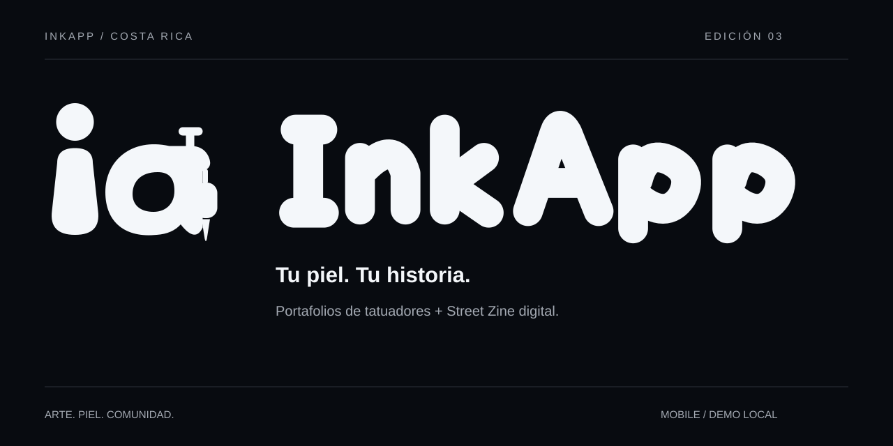

# InkApp



Una app móvil para descubrir tatuadores por estilo en Costa Rica. Portafolios sociales con el carácter editorial de una revista callejera: **Street Zine**.

**[Abrir la app en GitHub Pages](https://alvaroporras2002-coder.github.io/InkCollector/?v=inkapp-20261106-4)** · **[Abrir la demo publicada](https://ink-collector-cr-demo.doordash.chatgpt.site)**

> Edición 04 · Rediseño completo de InkApp. El repositorio conserva `InkCollector` en su dirección para mantener los enlaces existentes.

## El rediseño

- Identidad: firma redondeada con una **i** y una **a formada por una máquina de tatuar**.
- Negro espacial `#080B10`, blanco frío `#F4F7FA` y grises neutrales.
- Portada fotográfica a pantalla completa, título redondeado más delgado y navegación de cinco iconos.
- Street Zine con lectura de historias, guía de primer tatuaje y colección de estilos.
- Búsqueda dedicada por estilo, provincia y disponibilidad; colección de favoritos y comparación.
- Perfil del artista con identidad compacta, Desde el estudio, portafolio de tres imágenes y botón fijo Cotiza tu idea.
- Cotización en cuatro pasos, resumen y seguimiento de solicitudes.
- Panel del estudio, cotizaciones, citas, registro y curaduría de perfiles.
- Interfaz pensada para celular, controles accesibles y transiciones discretas con soporte de movimiento reducido.

## Probar la demo

1. Abre un perfil o usa **Mi idea** para elegir un artista.
2. Completa una solicitud con datos ficticios.
3. En **Mi espacio → Mis solicitudes**, consulta su seguimiento.
4. En **Mi espacio → Mi estudio**, simula la respuesta del tatuador y registra una cotización.
5. Acuerda una cita de ejemplo y explora el resto del recorrido.

Todos los artistas, imágenes y solicitudes de ejemplo son ficticios. No hay cuentas reales, pagos ni envío de mensajes. La demo usa `localStorage`; se conservaron las claves existentes para no perder favoritos y solicitudes al actualizar.

## Desarrollo

Sin dependencias ni claves API. Sirve la raíz de este repositorio con un servidor estático:

```sh
python3 -m http.server 8080
```

Abre `http://localhost:8080`.

```sh
npm test
npm run check
```

Los archivos CSS y JS usan un identificador de versión en sus URL para evitar reutilizar la estética anterior desde la caché.

## Publicación

`main` y `gh-pages` contienen la misma versión de la app en la raíz. El sitio de GitHub Pages depende de la configuración del repositorio y de que GitHub termine su despliegue. No requiere Jekyll.

Generated with [Codex](https://openai.com/codex/).
